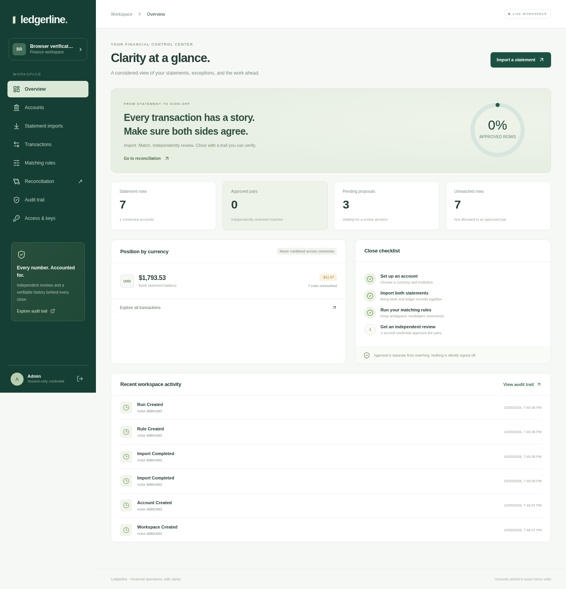

# Ledgerline

A financial reconciliation workspace for bringing bank statements and ledger records into agreement—without silently signing off on differences.

**React · TypeScript · TanStack Query & Table · Zod · Hono · Cloudflare D1**



## What it does

1. Create period-specific, single-currency accounts.
2. Preview and import bank and ledger CSV statements.
3. Match candidate pairs using explicit amount, date, and reference policies.
4. Preserve ambiguous candidates as unresolved rather than guessing.
5. Require a distinct reviewer credential to approve or reject proposals.
6. Finalize a reviewed snapshot while retaining unresolved exceptions.
7. Export match decisions and verify the workspace's hash-linked audit history.

### Completed features

- Responsive React workspace with eight operational views, accessible form feedback, typed TanStack tables, and a rendering recovery boundary.
- Exact integer minor-unit accounting, currency-specific precision, and reporting overflow guards. Different currencies are never combined into one balance.
- Quoted UTF-8 CSV parsing, row-indexed validation, import previews, atomic imports, normalized fingerprints, and external-ID deduplication.
- Rule-based one-to-one candidate scoring with same-sign enforcement, explicit reasons, bounded settlement windows, and conservative ambiguity handling.
- Frozen statement/rule snapshots, independent review decisions, immutable finalized runs, and cross-run double-allocation protection.
- Tenant-scoped API queries, admin/reviewer/viewer roles, expiring/revocable credentials, and protected administrator rotation.
- Transactional revision claims, immutable source records, hash-linked audit events, chain verification, and missing-tail detection.
- Persistent D1 request budgets, same-origin browser requests, bounded bodies, security headers, strict input schemas, and sanitized errors.
- Downloadable CSV templates, explicitly illustrative sample records, an HTTP smoke workflow, regression tests, and an optional CI template.

## Repository and status

- Repository: https://github.com/devnishantt/ledgerline
- Production URL: **not deployed**.
- Local application: http://localhost:3000 while the preview is running.
- Storage: Cloudflare D1 in production; Wrangler's local D1 emulator in development.
- Production D1 database and production operator secret: **not provisioned**.

The UUID in `wrangler.jsonc` is a local-development placeholder, not a production database identifier. No live banking connection, external financial data, or production customer account is included.

## Requirements

- Node.js 22 and npm for dependency installation/builds.
- Bun 1.4.4 for regression tests and the smoke script.
- A Cloudflare account and real D1 database only when you choose to deploy remotely.
- PM2 is optional; it manages the preview process in the example below.

## Local setup

```sh
npm ci
# Generate a local-only operator secret without placing its value in shell history.
printf 'BOOTSTRAP_TOKEN=%s\n' "$(openssl rand -hex 32)" > .dev.vars
chmod 600 .dev.vars
npm run db:migrate
npm run build
npm run preview
```

Keep the preview running in a separate terminal. For a managed background process instead:

```sh
npm run build
pm2 start ecosystem.config.cjs
curl --fail http://localhost:3000/health/ready
# Stop when finished:
pm2 delete ledgerline
```

`.dev.vars`, local databases, dependency directories, browser reports, and build outputs are ignored by Git. Never commit real operator tokens, API keys, statements, or banking credentials.

`npm run dev` is a frontend-only Vite server on port 5173. Use the built Wrangler preview on port 3000 for the integrated UI/API/D1 workflow. The frontend-only server does not provision an API proxy.

## Using the workspace

### Operator setup

Open the app and select **Operator setup: create a workspace**. Enter a workspace name and the local `BOOTSTRAP_TOKEN` from `.dev.vars`. Save the returned administrator key in a password manager; the API returns it only once.

The browser keeps credentials in memory—not local storage. Signing out or reloading clears the session and query cache. Do not use the workspace on an untrusted device.

### Reconcile statements

1. **Accounts:** create an account with a fixed currency and period-specific name.
2. **Statement imports:** select the account and statement side. Upload or paste CSV, validate it, review the preview, then commit it.
3. Import the other side into the same account.
4. **Matching rules:** create an amount/date/reference policy. Tolerance is in minor units: USD 100 = $1.00; JPY has no fractional digits.
5. **Reconciliation:** create a named run using that account and rule. The run snapshots both the statement IDs and the rule.
6. **Access & keys:** issue a reviewer credential for a separately controlled identity. Save it securely.
7. Sign out and connect as the reviewer. Approve or reject each proposal with a rationale.
8. Reconnect as an administrator and finalize the review when eligible.
9. Inspect unresolved rows, download the match-decision CSV, and verify **Audit trail**.

Finalization means the review record is closed, **not that every statement row has been reconciled**. All proposals must be reviewed and at least one pair approved. Rejected and unmatched rows remain explicit exceptions. There is no automatic adjustment, write-off, journal posting, or transfer of money.

### CSV contract

```csv
date,amount,currency,description,reference,external_id
2026-10-01,1250.00,USD,Invoice settlement,INV-1042,ROW-1042
2026-10-02,-84.50,USD,Studio supplies,PO-882,ROW-882
```

Required columns: `date`, `amount`, `currency`, `description`. Optional: `reference`, `external_id`. Dates must be real `YYYY-MM-DD` calendar days; amounts must be plain signed decimals without symbols, thousands separators, or exponent notation. The account currency must match every row.

- 1–200 rows per import; CSV text is limited to 200,000 characters and request bodies to 256,000 bytes.
- Maximum 400 statement rows per account. Create another period-specific account for a new period.
- Same-side duplicate normalized imports, row fingerprints, and nonempty external IDs are rejected atomically.
- No CSV content is sent to a third-party API.
- The supplied examples are illustrative. With the sample pair, a tolerance of 10 minor units and default score threshold produce three proposals, leaving the bank fee unresolved.

Templates: [blank example](public/static/examples/statement-template.csv), [bank sample](public/static/examples/bank.csv), [ledger sample](public/static/examples/ledger.csv).

## API reference

All `/api` routes except workspace provisioning require `Authorization: Bearer <workspace-key>`. Workspace provisioning requires the separate operator token. Viewer access is read-only; key management, account/rule creation, imports, run creation, and finalization require an administrator. Review decisions allow administrators/reviewers other than the run creator.

| Method | Path | Input / behavior |
| --- | --- | --- |
| GET | `/health/live` | Process liveness |
| GET | `/health/ready` | Migrated database readiness |
| POST | `/api/workspaces` | Operator token; `{name}`; returns initial key once |
| GET | `/api/me` | Current principal and workspace metadata |
| GET / POST | `/api/keys` | Admin metadata / `{label, role, expiresInDays?}` |
| DELETE | `/api/keys/:id` | Revoke another key; no self-revocation |
| GET / POST | `/api/accounts` | Account list / `{name, currency, institution?}` |
| GET | `/api/imports` | Latest 100 import metadata records |
| POST | `/api/imports/preview` | `{accountId, side, filename, csv}`; validate without writing rows |
| POST | `/api/imports` | Same input; atomic import and audit event |
| GET | `/api/transactions` | `accountId?`, `side?`, `search?`, `limit` (1–100), `offset` |
| GET / POST | `/api/rules` | Latest 200 / `{accountId, name, tolerance?, dateWindow?, referenceMode?, minScore?}` |
| GET / POST | `/api/runs` | Latest 100 / `{accountId, ruleId, name}` |
| GET | `/api/runs/:id` | Frozen rows, proposals, decisions, summary, current revision |
| POST | `/api/runs/:id/matches/:matchId` | `{expectedRevision, decision, note}`; decision is `approved` or `rejected` |
| POST | `/api/runs/:id/finalize` | `{expectedRevision}`; locks the reviewed record |
| GET | `/api/runs/:id/export` | CSV match-decision report, not a complete statement export |
| GET | `/api/dashboard` | Currency-separated positions, counts, and recent events |
| GET | `/api/audit` | `after` sequence, default -1; up to 100 events |
| GET | `/api/audit/verify` | Sequence, payload-hash, previous-hash, and head verification |

UI navigation uses hash paths: `#overview`, `#accounts`, `#imports`, `#transactions`, `#rules`, `#runs`, `#runs/<id>`, `#audit`, and `#keys`.

Errors use `{error:{code,message,requestId}}` and an `X-Request-Id` header. A 409 conflict requires refetching the latest state and deliberately deciding whether to retry. Writes are not retried automatically. If a request times out, check the audit history before repeating it: a write may have committed before the response was lost.

## Storage and concurrency

`workspaces`, `api_keys`, `accounts`, `imports`, `transactions`, `rules`, `runs`, `run_transactions`, `matches`, and `approved_allocations` model the workspace. `workspace_revisions` and `run_revision_claims` provide unique transactional write fences. `audit_events` stores the canonical payloads and hash chain. `request_limits` stores durable, short-lived ingress counters.

Each mutation claims a workspace revision, applies its writes, adds an audit event, and advances the stored head inside one D1 batch. Review/finalization mutations also claim a unique run revision. This prevents stale review writes even when workspace activity changes between reads. Database guards recheck active writer credentials and prevent last-admin revocation, source-row mutation, review rewriting, and finalized-run mutation.

Imports use bounded parameterized multi-row statements, staying below 90 bind values per insert. No application data is persisted in process memory or local files at production runtime. The in-memory SQLite adapter exists only in tests.

## Security boundaries

- Credentials contain 256 random bits and are stored as SHA-256 digests. They are high-entropy API keys, not user passwords. Initial admin keys expire in 30 days; other keys default to 30 days with a 365-day maximum. Rotate before expiry.
- Independent review means a **distinct API-key principal**, not verified distinct humans. Administrators can issue multiple keys. Enforce separate credential custody operationally; SSO and verified human identities are not implemented.
- Protect operator provisioning at your ingress. Never distribute `BOOTSTRAP_TOKEN` to ordinary users. Browser clients must never receive Cloudflare management tokens.
- Audit chains are tamper-evident, not cryptographic signatures or protection from an all-powerful database administrator. Preserve head hashes in independently controlled storage if you need to detect a complete privileged rewrite.
- The verifier validates event history, not a full re-execution of every materialized financial table. Immutable-record SQL triggers provide a separate layer of protection.
- Browser APIs are same-origin only. There is no cross-origin CORS policy or public financial-read API.
- Persistent budgets allow 180 API requests/minute/IP and 5 operator provisioning requests/minute/IP. Old counters are cleaned up lazily. Trust `CF-Connecting-IP` only behind Cloudflare or an ingress that overwrites it. Local clients share one fallback budget.
- Export cells are neutralized against spreadsheet formula injection. Negative numeric text may receive a leading apostrophe so spreadsheet software treats it as text intentionally.
- Matching is bounded to 400 statement rows per account, uses a quadratic candidate pass, and has not been production load-tested. Verify CPU, D1 limits, pagination requirements, and ingress behavior before real use.
- Monetary inputs are bounded at 9 trillion minor units per row. Reports fail explicitly rather than silently round aggregates outside JavaScript's exact integer range.

This is a reconciliation tool, not a regulated accounting system, bank connector, payment processor, or compliance certification.

## Verification

```sh
npm run typecheck
bun test ./tests
npm run build
npm audit --omit=dev
# Or all main checks:
npm run check
```

Verified locally: **153 passing domain/API regression tests**, strict application/tool typechecks, browser/edge builds, and a clean production dependency audit at the time of verification. Tests cover money precision, CSV edge cases, date boundaries, matching ambiguity, tenant isolation, key lifecycle, atomic rollback, concurrent reviews, stale revisions, immutable statements, audit corruption/missing tails, and body/origin/rate limits.

The full smoke workflow also passed against Wrangler's local D1 runtime—not only the test adapter:

```sh
# Start the built preview first. This creates a disposable workspace and records.
BOOTSTRAP_TOKEN="$(sed -n 's/^BOOTSTRAP_TOKEN=//p' .dev.vars)" bun scripts/smoke.ts
```

Browser checks passed in Chromium at desktop and mobile widths, visiting all workspace routes, reading live test records, checking mobile overflow, and signing out:

```sh
npx playwright install --with-deps chromium
BOOTSTRAP_TOKEN="$(sed -n 's/^BOOTSTRAP_TOKEN=//p' .dev.vars)" npm run test:e2e
```

Browser tests create disposable workspaces. Traces and automatic screenshots are disabled to avoid retaining credential-bearing views. An optional `LEDGERLINE_SCREENSHOT` path captures only the post-login illustrative overview.

An inactive CI template at `ci/github-actions.yml` typechecks, runs coverage, builds both bundles, and audits production dependencies. This GitHub connection cannot write active workflow files. To enable it from an account with workflow permission, copy it into `.github/workflows/ci.yml` and commit that change. A successful local run does not claim a successful GitHub Actions run or remote production validation.

## Deployment status and next steps

The project is prepared for Cloudflare Pages with a D1 binding, but **no production site or database has been deployed**. Static assets are served by Pages; `_routes.json` sends only `/api/*` and `/health/*` through Hono. `_headers` applies browser protections to native static responses.

Before deploying, create a real D1 database in the intended Cloudflare environment, replace the placeholder database UUID, provision the operator secret securely, apply all migrations remotely, and configure ingress protections and backups. Do not treat the local placeholder as a real resource. Use your chosen deployment platform's normal approval process.

Recommended next steps:
1. Load-test the bounded matcher and tune operational budgets against a real D1 instance.
2. Add SSO and organization membership for verified human reviewer separation.
3. Anchor audit checkpoints independently; establish backup and recovery procedures.
4. Add explicit exception-resolution workflows, adjustment journals, and many-to-one matching only with corresponding invariants and tests.
5. Add date-range/cursor paging for larger audit/report histories and structured observability.

Not implemented: bank synchronization, payment initiation, FX conversion, many-to-one matching, journal posting, automated write-offs, password login, SSO, notifications, or background jobs.

## History provenance

The **207 implementation and regression-test commits** use assigned historical dates between **January 1 and October 29, 2026 (UTC)**, with varied activity and skipped days. These timestamps are organizational metadata, not actual development dates. Each commit contains a concrete source, configuration, documentation, or regression-test change. The reserved schedule accounts for the other planned repositories under the requested combined daily maximum of eight commits.
